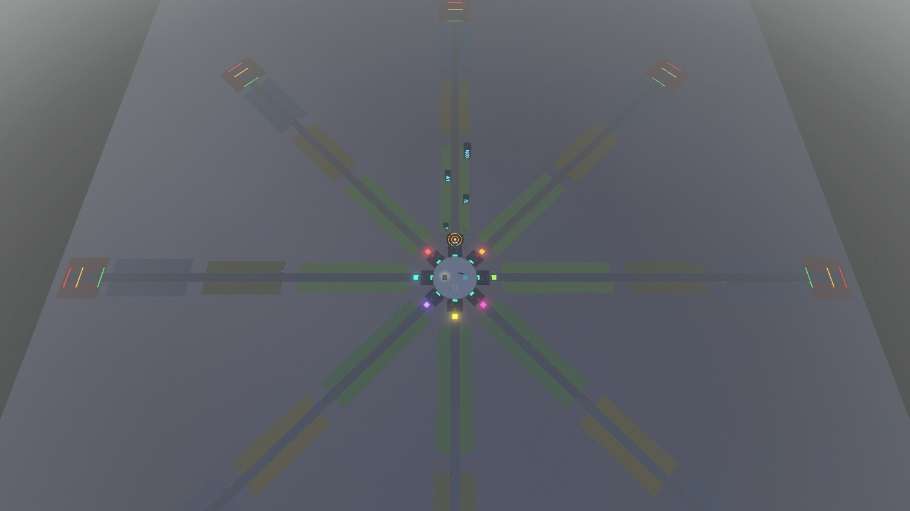

# 레벨디자인 실행안 v0.3 — 링 광장 + 기지별 진격 대로

[게임 기획서 v0.3](GDD_v0.3.md) · [레벨디자인 실행안 v0.3](LEVEL_DESIGN_v0.3.md) · 이전 버전: Codex 미러 `outputs/gdd-v02/LEVEL_DESIGN_v0.2.md`

> v0.2의 "현행 4건물 → 전진 동선 → 도시 3개 + 보스" 순서를 유지하고, 맵 공간 구조를 **링 광장 + 기지별 진격 대로**로 확정했다. 2026-11-09 Studio Place 122289987934213에 **그레이박스를 적용**했다(Save/Publish 안 함). 구역2·3·보스장은 바닥과 표지만 있는 자리이며, 건물·보스 기능은 아직 없다. 치수·시간·보상은 테스트용 제안값이다.

기준일: 2026-11-09 KST
대상: 프로젝트MS · PlaceId 122289987934213
서버 정원 목표: **8명** (기지 8개와 1:1)

# 0. v0.2에서 바뀐 점

| 항목 | v0.2 | v0.3 |
| --- | --- | --- |
| 공간 구조 | 기지 6개 격자 + 공용 위치의 도시 1개 | **원형 광장 둘레 기지 8개 + 기지마다 바깥으로 뻗는 대로** |
| 개인 도시 위치 | 모든 플레이어가 같은 좌표에 겹쳐 복제(다른 도시는 클라이언트에서 숨김) | **자기 기지 번호의 대로 위**에 복제. 겹침 없음 |
| 서버 정원 | 60 (기지 6과 불일치) | **8** 목표 (게시 설정은 사용자가 변경) |
| 월드1 건물 배치 | 입구 반경 90 안에 4개 밀집 | v0.2 A1 전진 동선 좌표를 대로 1에 적용 |
| 월드2 | X+420, 연결로(TravelRoad) | X+1720 바깥 섬. 연결로 제거(백업 보관). 진입은 기존 입구/버튼 이동 |
| 보스장 | 문서상 제안 | 대로 끝에 시작선·위험선·실패선 바닥 표시만 배치 |

**참고한 구조:** 최근 유행한 두 장르 문법에서 하나씩 가져왔다. 게임 자체를 따라 만드는 것이 아니라 공간 배치 원리만 참고한다.
- **기지 나열형** → 광장 둘레에 기지를 모아 **서로의 발사대 성장이 보이게** 한다. 남의 기지를 터는 PvP는 넣지 않는다.
- **직선 진행형** → **멀리 갈수록 강한 구역**. 거리가 곧 화력 단계가 되고, 대로 끝 보스(다가오는 장벽)와 자연스럽게 이어진다.

# 1. 레벨디자인이 해결할 질문

**플레이어가 광장에서 출격해 내 대로를 따라 다음 목표를 부수고, 보상을 주워 기지로 돌아와 더 많은 미사일로 더 멀리 나가고 싶어지는가?**

이동은 사거리 진입·회수·다음 구역 진입이라는 목적이 있어야 한다. 강화는 같은 목표의 파괴시간 변화와 "더 먼 구역에 갈 수 있음"으로 보여야 한다. 긴 무보상 걷기로 진행을 늘리지 않는다.

# 2. 현재 맵 (2026-11-09 Studio 적용, 구현 확인)



```text
                       [보스장 900~1000]
                              ▲
                     [구역3 680~880 (예정)]
                              ▲
                     [구역2 440~640 (예정)]
                              ▲
                [구역1 120~400: 주택·상가·사무실·연구동]
                              ▲  Lane_1 (대로 폭 22)
                         [Entry d=100]
                              ▲
            Base_8     [Base_1]     Base_2
        Base_7      ( 광장 r=56 )      Base_3
            Base_6      Base_5      Base_4
          (각 기지 뒤로 Lane_N이 45° 간격 방사형으로 뻗음)
```

| 요소 | 위치·크기 (광장 중심 0,0 기준, d = 중심에서 거리) | 비고 |
| --- | --- | --- |
| 광장 바닥 `ProjectMS_Lanes.PlazaFloor` | 반지름 56 원판 | 공용 공간. 스폰·월드1 입구·차고·중앙 전시물 |
| 기지 `ProjectMS_Bases.Base_1~8` | 중심 d=72, 45° 간격. Base_1이 -Z 방향, 시계방향으로 번호 증가 | 발판(ClaimPad)이 광장 쪽(d≈60). Base_7·8은 Base_1 복제 |
| 대로 `ProjectMS_Lanes.Lane_N.Road` | d=88~1000, 폭 22 | 기지 뒤에서 바깥으로 |
| 대로 입구 `Lane_N.Entry` | d=100, 12×12 네온 판 (충돌 없음) | 개인 도시 기준점. 월드1 복귀 시 도착 지점 |
| 구역 바닥 `Lane_N.Zone1~4_Ground` | 구역1 120~400(폭 80), 구역2 440~640(90), 구역3 680~880(100), 보스장 900~1000(110) | 색으로 구역 구분. 표지판은 대로 오른쪽 |
| 보스 선 | 시작 d=905(초록), 위험 960(주황), 실패 992(빨강) | 바닥 표시만 |
| 스폰 | (0, 26) | 광장 남쪽 |
| 월드1 입구 `ProjectMS_Worlds.World_1.Entry` | (26, 0) | 광장 동쪽. 기지가 있으면 내 대로 입구로 이동 |
| 차고 `ProjectMS_Garage` | (-26, 0) | 광장 서쪽 |
| 바닥판 `Baseplate` | 2048×2048 | 대로 끝(d=1000)까지 덮음 |
| 월드2 | 입구 (1720, 25), 바닥 220×220 | 대로와 겹치지 않는 바깥 섬 |

인접한 대로 중심선 사이 간격은 d×0.765다(d=140에서 약 107, d=400에서 약 306). 구역1 건물의 좌우 폭 ±45를 감안해 구역 바닥은 d=120부터 시작한다.

## 월드1 건물 (Lane_1 기준 실제 좌표)

| 건물 | 입구 기준 (좌우, 전진) | 실제 좌표 (Lane_1) | HP(배율 적용) / 부품 |
| --- | --- | --- | --- |
| 주택 | (-24, 40) | (-24, -140) | 15 / 20 |
| 상가 | (30, 120) | (30, -220) | 30 / 35 |
| 사무실 | (-20, 190) | (-20, -290) | 60 / 60 |
| 연구동 | (35, 270) | (35, -370) | 120 / 100 |

건물 사이 중심 거리는 약 96/86/97이다. 입구에서 주택만 사거리 90 안에 있고, 뒤의 목표는 전진해야 사거리에 들어온다. HP·보상·확률은 v0.2와 같다.

# 3. 동작 계약 (코드 반영, 구현 확인)

| 항목 | 규칙 |
| --- | --- |
| 기지 수 | `BaseConfig.PlotCount = 8`. `Base_1~8`의 `PlotId` 속성과 일치해야 함 |
| 대로 폴더 | `WorldConfig.LaneFolder = "ProjectMS_Lanes"`, 대로 이름은 `Lane_N`(N = 기지 번호), 안에 `Entry` 파트 필수 |
| 템플릿 대로 | `WorldConfig.TemplateLane = 1`. `ProjectMS_City` 건물은 **Lane_1 위에 배치된 그대로** 편집한다 |
| 개인 도시 복제 | 템플릿 좌표 × (`Lane_N.Entry` ⋅ `Lane_1.Entry`⁻¹). 자기 기지의 대로로 회전·이동해 복제 |
| 기지 없음 | 월드1 개인 도시를 만들지 않는다. 기지를 차지하는 순간 그 대로에 생성 |
| 기지 변경 | 기지 번호가 바뀌면(차지/해제) 도시를 새 대로에 다시 만든다 |
| 월드1 진입/복귀 | 기지가 있으면 `Lane_N.Entry`, 없으면 광장의 `World_1.Entry` |
| 월드2 | 기존처럼 템플릿 좌표 그대로(모든 플레이어 같은 위치, 다른 도시는 숨김) |
| 다른 플레이어 도시 | 기존대로 클라이언트에서 숨김·충돌 없음. 대로가 분리돼 겹침은 사라짐 |
| 장식 | `ProjectMS_City`의 직접 자식 Model은 완파 대상에 포함된다. 장식은 `ProjectMS_Lanes` 안에 Part로 둔다 |

변경 파일(Studio): `ServerScriptService.PetMissiles.ProgressionService`, `ServerScriptService.PetMissiles.BaseService`(공개 함수 `GetPlotId` 추가), `ReplicatedStorage.PetMissiles.BaseConfig`, `ReplicatedStorage.PetMissiles.WorldConfig`. 변경 전 원본은 `ServerStorage.ProjectMSBackups.BeforeRingPlaza_1794155422`.

# 4. 공간 흐름

```text
[광장: 스폰·차고·월드 입구, 다른 기지 구경]
        │ 발판 밟아 기지 차지 → 내 대로 개방
        ▼
[내 기지: 제작·장착] ──▶ [대로 입구 d=100]
                            │ 주택이 사거리 안: 첫 발 성공
                            ▼
                    [구역1 주택가 120~400]
                     주택 → 상가 → 사무실 → 연구동 (첫 완파)
                            │ 회수 후 기지 귀환·재제작 (밤 25초)
                            ▼
                    [구역2 상업가 440~640] (예정, 버기 권장)
                            ▼
                    [구역3 연구구역 680~880] (예정)
                            ▼
                    [보스장 900~1000: 장벽이 대로를 따라 접근]
                            │ 격파 → 다음 월드
                            ▼
                    [버기로 빠른 귀환]
```

- 광장은 **사회적 공간**이다. 다른 사람의 기지 발판 색·발사대 외형이 보인다. 전투는 하지 않는다.
- 대로는 **개인 공간**이다. 다른 플레이어의 도시는 보이지 않고 공격 대상도 아니다.
- 갈림길은 만들지 않는다. 대로 한 줄이 필수 동선이고, 구역 바닥 양옆이 선택 공간이다.

# 5. 거리와 이동 시간

| 구간 | 거리 | 걷기 16 | 버기 32 / 44 / 58 |
| --- | --- | --- | --- |
| 기지 → 대로 입구 | 약 28 | 약 2초 | — |
| 입구 → 연구동 (구역1 끝) | 270 | 약 17초 | 8 / 6 / 5초 |
| 기지 → 구역2 시작 | 약 370 | 약 23초 | 12 / 8 / 6초 |
| 기지 → 보스장 | 약 830 | 약 52초 | 26 / 19 / 14초 |

- 걷기 16은 Roblox 기본값을 가정했고 실측하지 않았다.
- 구역1은 걷기만으로 진행 가능하게 둔다(첫 반복, 버기 구매 전).
- 구역2부터는 걷기 이동이 "빈 이동 5~8초" 기준을 넘는다. **버기(부품 50)를 자연스럽게 사게 되는 지점**으로 설계하되 필수로 막지 않는다. 실측 후 구역 간격을 줄이거나 구역 사이에 보상 목표를 둔다.
- 밤 25초 동안 기지로 돌아오려면 구역1에서는 걸어서 가능하지만, 구역2 이후에서는 버기가 필요하다. 밤 정책(GDD 8절)과 함께 결정한다.

# 6. 먼저 할 실험 (v0.2의 A0/A1을 대체)

## B0. 링 광장 기준선

지금 적용된 배치 그대로 신규 데이터로 첫 반복(광장 스폰 → 기지 차지 → 제작 → 대로 입구 → 주택 파괴 → 회수 → 재제작 → 연구동 완파)을 기록한다. 기록할 시각은 v0.2 A0와 같고, **광장에서 기지를 찾는 시간**과 **기지에서 대로 입구까지 가는 시간**을 추가한다.

## B1. 구역 간격 조정

B0에서 빈 이동이 길면 구역1 건물 간격(96/86/97)부터 줄인다. HP·보상은 고정한다. 대로 길이나 기지 반지름은 B1에서 바꾸지 않는다.

v0.2의 A0(기존 밀집 배치)는 백업(`BeforeRingPlaza_1794155422`)으로 복원해야만 측정할 수 있다. 비교가 꼭 필요할 때만 별도 사본에서 한다.

# 7. 첫 반복의 연출과 안내

| 순간 | 보여줄 것 | 피할 것 |
| --- | --- | --- |
| 접속 | 광장 중앙, 빈 기지 발판 8개의 "빈 기지 N" 표지 | 상점·차고·연구·보스 설명을 한꺼번에 노출 |
| 기지 차지 | 발판 색 변화, 내 대로 입구 네온과 "기지 N 진격로" 표지 | 대로가 어디인지 모르게 두기 |
| 첫 제작 | 비용 20·남은 5초·자동장착 결과 | 지급 전 전투하라는 안내 |
| 첫 파괴 | HP 감소→폭발→부품 위치 | 파괴만 강조하고 회수 목적을 숨김 |
| 첫 회수 | 추가된 자원 알림·소리, 잔액 변화 | 색만으로 소유·종류 구분 |
| 두 번째 제작 | "미사일 2개 장착"과 다음 공격의 발사량 | 희귀도 결과만 강조 |
| 첫 완파 | 4/4 완료, 구역2 표지와 버기 안내 | Win만 표시하고 사용할 곳을 감춤 |

## 체력 단계별 손상 연출 (2026-11-09 구현)

`StarterPlayerScripts.BuildingDamageClient`(클라이언트 전용). 내 개인 건물만 처리하며 판정·체력·보상은 바꾸지 않는다. 수치는 `SalvageConfig.Damage*`.

| 체력 | 단계 | 보이는 변화 |
| --- | --- | --- |
| 맞을 때마다 | — | 건물이 짧게 흔들림(0.35 스터드, 0.07초) |
| 75% 이하 | 1 | 창문 1/3 꺼짐, 몸체·지붕 그을음, 파편 4개 |
| 50% 이하 | 2 | 창문 2/3 꺼짐, 그을음 증가, 파편 7개, 꼭대기 연기, 1.5° 기울기 |
| 25% 이하 | 3 | 창문 전부 꺼짐, 파편 10개, 불길 + 짙은 연기, 4° 기울기 |
| 0 | 붕괴 | 연기·불 제거 후 기존 정육면체 붕괴 연출 |

- 창문이 꺼지는 순서와 기울기 방향은 BuildingId로 정해져 매번 같다.
- 파편은 동시 60개 상한, 2.5초 뒤 사라진다. 연기·불은 엔진 기본 텍스처(`rbxasset://textures/particles/...`)를 써서 업로드 에셋이 필요 없다.
- 한 발에 여러 단계를 넘으면 넘은 단계의 변화가 한꺼번에 적용된다. 한 발에 파괴되는 건물(예: 주택 HP 15)은 손상 단계 없이 바로 붕괴한다.

현행 SalvageClient의 회수 알림·연구 기둥·드롭 강조를 먼저 활용한다. 연구자료 소비가 없으므로 연구자료를 반드시 줍도록 튜토리얼을 막지 않는다.

# 8. 수치 조정 방법

v0.2 6절을 그대로 따른다. 요약:
- 필요 명중수는 단순 계산값이다. **HP÷15÷1.6을 DPS로 쓰지 않는다.** 일반 미사일 1/3/5/10개, 사거리 30/60/90 근처, 자동·집중, PC·모바일 조건으로 실측한다.
- 총 진행시간 = 공격 + 타깃 전환 + 회수 이동 + 기지 왕복 + 제작/장착 + 안내 이해 + 밤 대기. 항목별로 적는다.
- 보상 효율 = 회수 확정 부품 ÷ 출격부터 귀환·제작을 포함한 시간. 월드2의 HP 4배·같은 보상 문제는 별도 실험.

# 9. 구역 구성안 (구역2·3·보스는 제안)

| 구역 | 대로 거리 | 목표물 후보 | 새 경험 | 통과 때 보여줄 것 |
| --- | --- | --- | --- | --- |
| 1. 주택가 | 120~400 | 4개, 현재 키트 (구현) | 한 발 성공·회수·재제작 | 첫 완파, 구역2 표지, 슬롯 3 후보 |
| 2. 상업가 | 440~640 | 6개, 상가·사무실 반복 | 두 목표 중 우선순위 선택·연속 화력 | 다음 큰 실루엣 |
| 3. 연구구역 | 680~880 | 8개, 큰 목표 1개 중심 | 화력 집중·마무리 시험 | 보스장 입구 활성화 |
| 보스장 | 900~1000 | 이동 장벽 1개 | 제한시간 화력·사거리 유지 | 다음 월드·슬롯 5 후보 |

- 구역 바닥 폭(90/100/110) 안에 목표를 배치한다. 대로를 막지 않는다.
- 구역2·3을 구현하려면 지금 "월드 = 건물 묶음 1개" 구조에 **구역(CityId) 계층**이 필요하다. 후보: `ProjectMS_City` 아래 `Zone_1~3` 폴더로 나누고, 같은 대로 변환으로 복제한다. 완파 분모·해금 조건·저장 마이그레이션은 별도 설계.
- 3구역 18목표는 첫 콘텐츠 후보이며 검증 결과에 따라 줄인다. 1인당 약 600파트, 8명 약 5,000파트로 추정한다(아래 11절).

# 10. 보스장 구현안 (사용자 검토 대기, 미구현)

- 장벽 1개가 **대로를 따라 광장 방향(안쪽)으로** 전진하고, 실패선에 닿기 전에 파괴하면 성공한다.
- 대로가 기지마다 따로 있으므로 **보스도 개인 인스턴스**로 만든다. 월드1 도시와 같은 대로 변환(`Lane_N.Entry` ⋅ `Lane_1.Entry`⁻¹)을 사용한다.

**바닥 선 배치 오류(수정 필요):** 2026-11-09 그레이박스의 선은 초록(시작) d=905, 주황(위험) 960, 빨강(실패) 992다. 장벽이 바깥(d≈1000)에서 안쪽으로 오면 실패선은 **안쪽**에 있어야 하므로 순서가 반대다. 구현 때 빨강(실패) d≈905, 주황(위험) d≈935, 장벽 출발 d≈995로 다시 놓는다.

| 항목 | 제안 |
| --- | --- |
| 장벽 모델 | 폭 약 60, 높이 약 30. `Humanoid` + `HumanoidRootPart` 구조로 만들어 기존 전투(타깃 검증·피해·붕괴·보상)와 손상 단계 연출을 그대로 재사용. 템플릿은 Lane_1 보스장에 둔다 |
| 시작 | 보스장 입구(d≈900)의 "도전" 패드. 지금은 **월드1 완파**를 조건으로, 구역 계층이 생기면 구역3 완료로 바꿈 |
| 이동 | 서버가 고정(Anchored) 장벽의 위치를 매 프레임 갱신. 이동 거리 약 90 ÷ 도전시간 35초 ≈ 초당 2.6 |
| 체력 | **실측 유효 DPS × 25초**. 예: 일반 미사일 10개면 이론상 초당 약 50 → 약 1,250. 실측 후 확정 |
| 성공 | 체력 0 → 영구 기록 `BossCleared[월드]`, 다음 월드 해금 조건에 추가, 보상 1회 |
| 실패 | 장벽이 실패선 도달 → 장벽 제거, 준비 지점으로 이동, 손실 없음, 5초 뒤 재도전 |
| 밤 | 보스 도전 중에는 밤 공격 거절을 적용하지 않거나, 남은 낮 시간이 40초 미만이면 시작을 막는 안 중 선택 |
| 화면 | 보스 체력 막대, 남은 거리, 실패 원인(화력 부족/사거리 이탈) |
| 새 파일(예정) | `BossConfig`(설정), `BossService`(서버 상태: 대기→진행→성공/실패). 수정: `ProgressionService`·`ProgressionRules`(해금·저장), `WorldProgressClient`(화면) |
| 검증 | 성공(높은 피해)·실패(무피해)·5초 재도전·재접속 후 기록 유지·8명 동시 개인 보스 |

# 11. 성능·멀티플레이 (8명 기준)

2026-11-09 Studio에서 읽기 전용으로 측정한 값이다. 게시 서버·실기기 측정은 아직 안 했다.

| 항목 | 값 |
| --- | --- |
| 월드1 도시 템플릿 | 파트 134개 |
| 기지 1개 / 버기 1대 | 파트 5개 / 20개 |
| StreamingEnabled | 켜짐, 반경 1024 |
| 8명 × 현재 도시 | 약 1,100파트 + 기지·버기 → 약 1,500파트 |
| 8명 × 3구역 18목표 (제안) | 약 5,000파트 추정 |

- 대로가 방사형으로 갈라져 있어, 스트리밍 반경 안에 다른 사람의 먼 구역이 덜 들어온다.
- **8명 상한 검토 결과 (2026-11-09, 코드 확인, 값 유지)**:
  1. `Config.MaxActiveFlights = 150`(서버 공용): 재장전 3초 > 최대 비행 2.5초라 1인 동시 비행은 최대 10발. 8명 × 10 = 80 < 150.
  2. `SalvageConfig.MaxDrops = 150`(서버 공용): 8명 × 건물 4 × 드롭 최대 4 = 128 < 150. 넘쳐도 같은 소유자 드롭에 합치거나 바로 지급해 보상 손실 없음. 구역을 늘리면 다시 계산.
  3. 개인 건물 붕괴 연출은 서버가 소유자에게만 보냄(`SalvageService`의 `FireClient(owner, "BuildingCollapse")`) → 자기 도시만 그림.
  4. 남은 일: 모바일 실기기에서 8명 동시 발사·붕괴·손상 연출 프레임 측정.
- 서버 정원 8은 Creator Dashboard(또는 Studio Game Settings)에서 **사용자가 직접** 바꾼다. 스크립트로 바꿀 수 없다.

# 12. Studio 작업 순서와 데이터 계약

1. **완료 (2026-11-09):** 링 광장 8기지, 대로 8개, 구역 바닥·표지·보스 선, 월드1 건물 A1 동선, 개인 도시 대로 복제 코드. Save/Publish 안 함.
2. **B0 기록:** 신규 프로필로 광장 → 기지 → 구역1 완파까지 시각 기록.
3. **B1 조정:** 구역1 간격만 조정.
4. **회수·귀환 확인:** 드롭이 대로 밖·건물 밑에 놓이지 않는지, 수집 8, 만료 90초.
5. **구역 계층 구현:** WorldId/ZoneId/BuildingId, 구역별 완료·보스 해금·다음 월드 조건을 서버에 추가.
6. **구역2·3 + 보스 1개:** 한 세션·재접속으로 전체 흐름 검증.
7. **아트 교체:** 피벗·충돌·타깃 루트·대로 폭을 유지하며 키트 교체.
8. **월드2·3:** 같은 링 + 대로 구조를 다른 테마로 재사용할지, 별도 섬으로 둘지 결정.

## 편집 시 지켜야 할 것

| 항목 | 유지해야 할 것 |
| --- | --- |
| 월드1 템플릿 | `Workspace.ProjectMS_City`의 직접 자식 Model, **Lane_1 위 좌표로 편집** |
| 대로 | `Lane_N.Entry`의 위치·방향이 복제 기준. Entry를 옮기면 그 대로의 도시도 같이 옮겨짐 |
| 기지 | `Base_N`의 `PlotId` = N, 자식 Floor·ClaimPad(OwnerSign/Claim)·Generator(Roll)·Display·Storage(Inventory) |
| 모델 식별 | BuildingId 고유값, 월드 안에서 중복 금지 |
| 밸런스 | BuildingHealth·ScrapReward·ResearchChance·ResearchReward 속성. WorldConfig HP 배율과 중복 증폭 주의 |
| 런타임 | 시작 시 템플릿이 ServerStorage로 옮겨지고 개인 복제에 OwnerUserId·WorldId·CycleId가 붙음. Play 중 생긴 개인 건물을 고쳐서 레벨을 만들지 않음 |
| 월드2 | `World_2.Buildings`, `World_2.Entry`. 현재 X+1720 섬 |

# 13. 아트 전달용 최소 에셋 목록

| 에셋 | 첫 묶음 | 계약 |
| --- | --- | --- |
| 광장 | 바닥, 중앙 랜드마크, 기지 사이 경계 | 반지름 56 안. 8방향 대로 입구가 보여야 함 |
| 기지 | 8개 공통 키트 + 번호·색 표식 | 38×32 바닥, 발판이 광장 쪽 |
| 주택/상가/사무실/연구동 | 각 1개 기본 + 색 변형 | 실제 크기·피벗·루트·단순 충돌체 공유 |
| 대로 | 직선 도로, 구역 경계 게이트 | 폭 22. 구역마다 바닥 재질 차이 |
| 안내 | 기지·대로 입구·다음 구역·보스·귀환 표식 | 작은 화면에서 글자 없이도 방향 인지 |
| 배경 | 대로 사이 쐐기 공간의 스카이라인·지형 | 필수 목표와 실루엣·색 구분, 다른 대로를 가리는 용도 |
| 보스 | 장벽 본체·위험선·핵심 파괴 효과 | 대로 축으로 이동, 판정 루트 고정 |
| 성장 장비 | 1/3/5/8/10단계 실루엣 후보 | 화면 가림·캐릭터 충돌 확대 금지 |
| 피드백 | 발사·착탄·붕괴·회수·제작 | 저효과 설정에서도 목표와 보상 식별 |

먼저 구역1과 광장으로 재미를 통과시킨 뒤 구역 수·면적을 아티스트에게 확정 전달한다.

# 14. 테스트 기록표와 합격 기준

작은 내부 탐색 테스트 5명, PC·모바일 포함을 권장한다. 아래는 이번 프로토타입의 의사결정용 후보 기준이다.

| 지표 | 기록 | 1차 후보 기준 |
| --- | --- | --- |
| 기지 찾기 | 스폰부터 기지 차지까지 시간·헤맴 | 5명 중 4명 30초 이내 |
| 대로 인지 | 기지에서 자기 대로로 바로 가는가 | 5명 중 4명 도움 없이 |
| 첫 반복 완료 | 제작→파괴→회수→재제작 | 5명 중 4명 도움 없이 |
| 다음 목표 인지 | 다음 건물·구역으로 스스로 이동 | 5명 중 3명 이상 |
| 빈 이동 | 공격·회수·목표 예고 없는 구간 | 5~8초 이상 구간 점검 |
| 화력 성장 | 같은 표적 1개/3개 장착 파괴시간 | 발사량·속도 향상을 인지 |
| 밤 영향 | 공격 거절·귀환 실패·기다림 | 신규 필수 진행을 막는 사례 해결 |
| 광장 상호작용 | 다른 기지를 구경·비교하는가 | 관찰 메모 |
| 저장 | 기지·도시·장비·자원 재접속 전후 | 중복·유실 없이 정책대로 보존 |

관찰 템플릿: 테스트ID / 빌드 / B0 또는 B1 / 기기 / 기지 번호 / 장착·희귀도 / 입장 주기시간 / 사건별 시각 / 이동경로 / 도움 횟수 / 막힌 이유 / 다음 행동 예측 / 수정 1개.

# 15. 바로 시작할 작업 3개

- [ ] B0: 링 광장 배치로 첫 반복을 기록하고, 기지 찾기·대로 인지 시간을 잰다.
- [ ] 8명 준비: 비행·드롭 상한을 인원 기준으로 다시 정하고, 서버 정원을 8로 바꾼다(정원은 사용자).
- [ ] PC·모바일 신규 이용자에게 첫 반복을 시켜, 광장→기지→대로→회수에서 막히는 원인 한 가지를 고친다.

이 3개가 끝나면 구역2·3과 보스장의 크기·제작량을 정한다.
