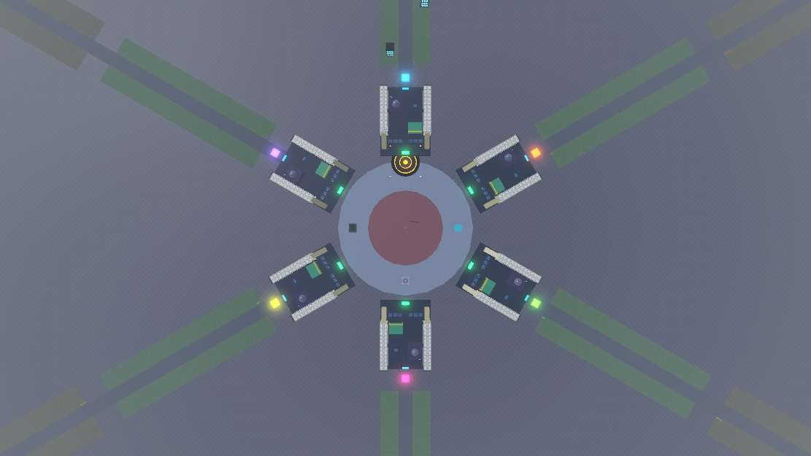
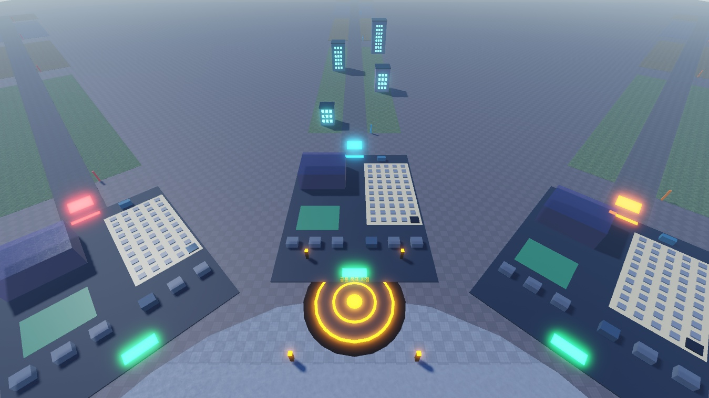
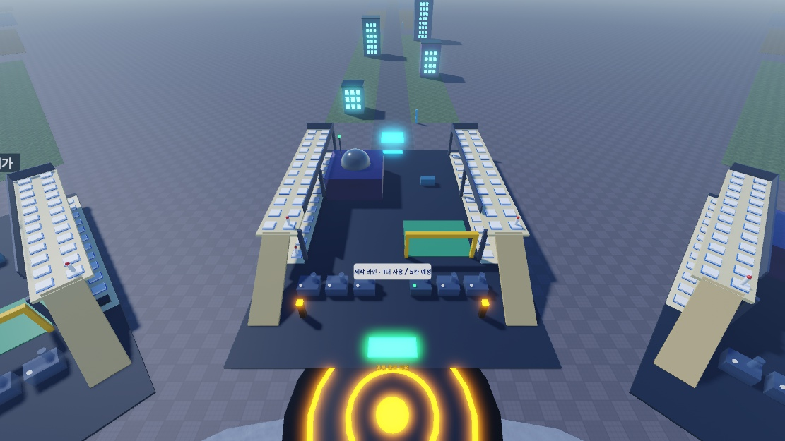

# 레벨디자인 실행안 v0.3 — 링 광장 + 기지별 진격 대로

> **2026-11-13 적용:** 미사일 전시장 총96칸 중 왼쪽1층 첫 칸만 기본 해금. 나머지는 반투명 예정 시설. 첫 전시대 E로 코인50(임시 비용)에 1칸씩 확장하며 GallerySlots에 저장한다. 전시 공간 해금이며 미사일 장착 수와 별개다. 추가 칸의 미사일 전시·도감·수익은 후속. 구역1은 기존8채를 유지하고 앞뒤 중심 분포를230→156 stud로 줄였다.


> **용어(2026-11-10):** 일반 재화의 화면 이름은 **코인**이다(예전 "부품", 게임 저장 키는 그대로 `Scrap`). 이 문서 본문의 "부품"은 코인으로 읽는다.

[게임 기획서 v0.3](GDD_v0.3.md) · [레벨디자인 실행안 v0.3](LEVEL_DESIGN_v0.3.md) · 이전 버전: Codex 미러 `outputs/gdd-v02/LEVEL_DESIGN_v0.2.md`

> v0.2의 "현행 4건물 → 전진 동선 → 도시 3개 + 보스" 순서를 유지하고, 맵 공간 구조를 **링 광장 + 기지별 진격 대로**로 확정했다. 2026-11-09 Studio Place 122289987934213에 **그레이박스를 적용**했다(Save/Publish 안 함). 같은 날 기지를 **80×110 타이쿤 구획**(제작 라인·전시장·차고·AFK 연구시설 자리)으로 키우고 광장 가운데에 **공동 레이드 자리**를 잡아 다시 그레이박스했다(2·2-1·2-2절). 구역2·3은 바닥과 표지만 있는 자리이며, 건물 기능은 아직 없다. 보스는 **핵미사일 요격**으로 정했고 아직 구현하지 않았다(10절). 치수·시간·보상은 테스트용 제안값이다.

기준일: 2026-11-09 KST
대상: 프로젝트MS · PlaceId 122289987934213
서버 정원 목표: **6명** (기지 6개와 1:1, 2026-11-10 8명에서 축소)

# 0. v0.2에서 바뀐 점

| 항목 | v0.2 | v0.3 |
| --- | --- | --- |
| 공간 구조 | 기지 6개 격자 + 공용 위치의 도시 1개 | **원형 광장 둘레 기지 6개(2026-11-10 8개에서 축소) + 기지마다 바깥으로 뻗는 대로** |
| 기지 크기 | 38×32 (생산기 1·전시 1·보관함) | **80×110 타이쿤 구획**: 제작 라인 6칸, 전시장 50칸, 기지 차고, AFK 연구시설 자리 (예정 시설은 반투명) |
| 광장 | 공용 시설만 | 반지름 108, **가운데 공동 보스 레이드 구역**(반지름 60, 예정) |
| 개인 도시 위치 | 모든 플레이어가 같은 좌표에 겹쳐 복제(다른 도시는 클라이언트에서 숨김) | **자기 기지 번호의 대로 위**에 복제. 겹침 없음 |
| 서버 정원 | 60 (기지 6과 불일치) | **8** 목표 (게시 설정은 사용자가 변경) |
| 월드1 건물 배치 | 입구 반경 90 안에 4개 밀집 | v0.2 A1 전진 동선 좌표를 대로 1에 적용 |
| 월드2 | X+420, 연결로(TravelRoad) | X+1720 바깥 섬. 연결로 제거(백업 보관). 진입은 기존 입구/버튼 이동 |
| 탈것 | 정찰 버기 3단계 | 호버보드 → 추진기 보드 → 소형 호버바이크로 변경 예정(기획). 이 문서의 "버기"는 이 탈것을 뜻하며 속도 32/44/58 기준 |
| 보스 | 문서상 제안(다가오는 장벽) | **핵미사일 요격**을 유지하고, 탈것 비행으로 보스 구역에 진입(10절, 미구현) |

**참고한 구조:** 최근 유행한 두 장르 문법에서 하나씩 가져왔다. 게임 자체를 따라 만드는 것이 아니라 공간 배치 원리만 참고한다.
- **기지 나열형** → 광장 둘레에 기지를 모아 **서로의 발사대 성장이 보이게** 한다. 남의 기지를 터는 PvP는 넣지 않는다.
- **직선 진행형** → **멀리 갈수록 강한 구역**. 거리가 곧 화력 단계가 된다. 구역을 다 밀면 내 기지로 떨어지는 핵미사일 보스가 나타난다.

# 1. 레벨디자인이 해결할 질문

**플레이어가 광장에서 출격해 내 대로를 따라 다음 목표를 부수고, 보상을 주워 기지로 돌아와 더 많은 미사일로 더 멀리 나가고 싶어지는가?**

이동은 사거리 진입·회수·다음 구역 진입이라는 목적이 있어야 한다. 강화는 같은 목표의 파괴시간 변화와 "더 먼 구역에 갈 수 있음"으로 보여야 한다. 긴 무보상 걷기로 진행을 늘리지 않는다.

# 2. 현재 맵 (2026-11-09 큰 기지 재배치 적용, 구현 확인)



(이전 8개 배치: big-bases-top.jpg)



**재배치 이유(사용자 요청, 2026-11-09):** 기지(타이쿤)가 너무 좁았음. 앞으로 제작기 여러 대(높은 등급 제작은 시간이 길어 동시에 여러 대), 미사일 전시 공간 대폭 확대, AFK 연구시설, 기지별 탈것 소환 자리, 광장의 공동 보스 레이드 자리가 필요함. 첫 배치(기지 38×32, 광장 반지름 56)는 `ServerStorage.ProjectMSBackups.BeforeBigBases_1794161033`에 보관.

```text
                     [대로 끝 1040~1140 (미정)]
                              ▲
                     [구역3 820~1020 (예정)]
                              ▲
                     [구역2 580~780 (예정)]
                              ▲
                [구역1 260~540: 8채 (주택·상가·사무실·연구동 + B 3채·창고)]
                              ▲  Lane_1 (대로 폭 22)
                         [Entry d=240]
                              ▲
                 [Base_1  80×110, 중심 d=170]
                              ▲
        ( 광장 r=108 · 가운데 공동 레이드 구역 r=60 )
          (기지 6개가 60° 간격, 각 기지 뒤로 Lane_N)
```

| 요소 | 위치·크기 (광장 중심 0,0 기준, d = 중심에서 거리) | 비고 |
| --- | --- | --- |
| 광장 바닥 `ProjectMS_Lanes.PlazaFloor` | 반지름 108 원판 | 공용 공간 |
| 공동 레이드 구역 `ProjectMS_Lanes.RaidArena` | 반지름 60 붉은 원판 + 중앙 표시 기둥 | **예정**. 공동 보스 레이드 자리. 지금은 표시만 |
| 기지 `ProjectMS_Bases.Base_1~6` | **80×110**, 중심 d=170 (앞 끝 d=115, 뒤 끝 d=225), 60° 간격. Base_1이 -Z 방향 | 앞(광장 쪽)에 발판. 인접 기지 앞 끝 간격 약 35 (8개일 때 약 8) |
| 대로 `Lane_N.Road` | d=225~1140, 폭 22 | 기지 뒤 출구에서 바깥으로 |
| 대로 입구 `Lane_N.Entry` | d=240 | 개인 도시 기준점. 월드1 진입 시 도착 지점 |
| 구역 바닥 `Lane_N.Zone1~4_Ground` | 구역1 260~540(폭 80), 구역2 580~780(90), 구역3 820~1020(100), 대로 끝 1040~1140(110) | 대로 끝 보스 선은 이번 재배치에서 제거 |
| 스폰 | (0, 84) | 레이드 구역과 기지 사이 고리 |
| 월드1 입구 `World_1.Entry` | (84, 0) | 기지가 있으면 내 대로 입구로 이동 |
| 공용 차고 `ProjectMS_Garage` | (-84, 0) | 탈것 메뉴 발판(기지 없는 사람용). 기지별 차고도 연결됨 |
| 바닥판 | `Baseplate` 2048×2048 + `ProjectMS_Lanes.BaseplateExtension_N/S/E/W` (200 폭) | 대로 끝(d=1140)까지 덮음 |
| 월드2 | 입구 (1720, 25) | 대로와 겹치지 않는 바깥 섬 |

인접한 대로 중심선 사이 간격은 기지 6개(60°)일 때 d×1.0이다(d=280에서 약 280). 기지 폭 W, 앞 끝 거리 r에서 `r × 1.0 ≥ W + 여유`를 만족하면 이웃 기지와 겹치지 않는다. 6개로 줄인 뒤 앞 끝 간격은 약 35.

## 2-1. 기지(타이쿤) 구획 (그레이박스, 2026-11-10 전시장 좌우·2층 개편)



**개편 이유(사용자 요청):** 미사일 전시 공간을 타이쿤 좌우 양옆으로 나누고 2층 구조로. 프로토타입이어도 각 모델이 무엇인지 형태·색·배치로 알아볼 수 있게(이름표는 보조). 이전 배치(왼쪽 1층 50칸)는 `ServerStorage.ProjectMSBackups.BeforeGalleryTwoFloor_1794235490`.

기지 로컬 좌표: 좌우 x(-40~40), 앞뒤 z(-55 광장 쪽 ~ +55 대로 쪽). 기지마다 같은 배치를 회전해 쓴다.

```text
              ┌──────────────── 뒤 (대로 쪽) · 출구 z=+53 ────────────────┐
              │ 왼쪽 전시장 │ 기술 개발실   │ AFK 연구시설   │ 오른쪽 전시장 │
              │ 1층 24칸    │ 청록 단말     │ 보라 대기실    │ 1층 24칸      │
              │ 2층 24칸    │               │ (15,+24)       │ 2층 24칸      │
              │ (x -40~-28) │ 기지 차고     │                │ (x 28~40)     │
              │  ↑ 경사로   │ 노란 문틀     │    통로        │  ↑ 경사로     │
              │ (z -44~-21) ├─ 제작 라인 6칸 (z=-32): 기계+굴뚝+신호등 ──┤ (z -44~-21) │
              └────────────────── 앞 (광장 쪽) · 발판 z=-50 ──────────────┘
```

| 구획 | 위치·크기 | 상태 | 알아보는 법(형태·색) |
| --- | --- | --- | --- |
| 바닥 `Floor` | 80×110 | 구현 | — |
| 발판 `ClaimPad` | 앞 중앙 (0, -50) | 구현 | 광장 쪽 입구 |
| 미사일 전시장 `Layout.Gallery` | **좌우 가장자리**(폭 12, z -21~52), **1층·2층**. 한쪽 한 층 2열×12행 = 24칸, **총 96칸**. 2층 바닥 높이 12.65, 안쪽 난간·기둥 | 1칸 구현(왼쪽 1층 1번 = `Display`, 제작 미리보기), 95칸 예정 | 미색 바닥, 흰 받침 + 파란 테두리, 각 층·측면 첫 칸에 미사일 견본(흰 몸통 + 빨간 머리), 이름표 "미사일 전시장 · 왼쪽/오른쪽 N층 · 24칸" |
| 2층 경사로 `Gallery.Ramp_left/right` | 각 전시장 앞(z -44 바닥 → z -21 2층), 폭 8, 약 28° | 구현(걸어서 오르기 확인) | 모래색 경사로, 이름표 "↑ 2층 전시장" |
| 제작 라인 `Layout.Production` | 앞쪽 가운데 z=-32, x=±8/±16/±24 6칸(가운데 통로 약 10) | 1칸 구현(`Generator`), 5칸 예정(반투명) | 회청색 기계 본체 + 원통 굴뚝 + 신호등(사용 중 초록, 예정 회색) |
| 기지 차고 `Layout.VehiclePad` | 가운데 왼쪽 앞 22×18 | **구현**: 프롬프트 `OpenGarage`(E)로 탈것 메뉴, 주인만 | 초록 발판 + 노란 문틀 게이트(`Layout.Garage`) |
| AFK 연구시설 `Layout.AFKLab` | 로컬 (+15,+24), 22×24 | 외형 분리 적용(2026-11-13), 보상 기능 후속 | 보라색 열린 대기실 + 휴식 의자 2개 + 시계 + 돔/안테나. 대기 바닥과 AFK 표지 |
| 제작대 등급 업그레이드 단말 (제안 이름 `Layout.ProductionUpgrade`) | 제작 라인 바로 뒤 가운데 근처(제안 (0, -22)), 가운데 통로를 막지 않는 작은 단말 | 기획(2026-11-13) | 연구자료 색 단말 + 설계도 아이콘 + 등급 표지판 |
| 기술 개발실 `Layout.TechLab` | 로컬 (-15,+24), 22×20, 옛 보관함 자리 | 외형 분리 적용(2026-11-13), 기술 메뉴 후속 | 청록색 프레임 + 작업대 + 미사일 설계도 화면 + 개발 단말. AFK와 별도 표지 |
| 패시브 뽑기 장치 (제안 `Layout.PassiveGacha`) | 연구 구역: 기술 개발 단말 옆(가운데 왼쪽 뒤) | 기획(2026-11-13) | 캡슐 뽑기 기계 모양, 기술 개발 단말과 다른 색 |
| 옛 보관함 `Storage` | 가운데 왼쪽 뒤 (-15,+24) | 원본 보존·숨김. 미사일 목록은 HUD 사용 | 옛 표지 숨김, 공간은 기술 개발실로 활용 |
| 대로 출구 `Layout.LaneExit` | 뒤 중앙 | 구현(표시) | 파란 네온 + "대로로 출격 →" |

- **연구 구역 (2026-11-13 결정):** 기지 뒤쪽 가운데 줄(왼쪽: 기술 개발 단말 + 패시브 뽑기 장치, 오른쪽: AFK 연구동)을 연구 구역으로 묶는다. 대로 출구(뒤 중앙) 통로는 비워 둔다. 보관함 시설은 2026-11-10 제거돼 왼쪽 뒤 자리가 비어 있다(표의 보관함 행은 이전 기록). 좌표는 제안값이며 그레이박스 때 확정. 시설 역할은 GDD 5-1절 "연구 관련 시설 배치와 화면 구성".
- 예정 시설은 `Base_N.Layout` 아래 폴더(Gallery·Production·Garage·AFKLab)에 있다. 코드는 `Layout.VehiclePad`만 참조한다.
- 기존 코드가 찾는 이름(`Floor`·`ClaimPad`·`Generator`·`Display`·`Storage`)은 그대로 유지했다. 위치(와 Display 크기 3×3)만 바꿨다.
- 기지 파트 수: 기지당 약 254, 6개 합계 약 1,524 (8개일 때 2,032).

연구시설 분리 적용(2026-11-13): 기지6개에 같은 배치를 회전 적용. 두 시설 사이 중앙 통로 폭8 stud 확보, 기술 개발실 뒤쪽은 패시브 장치 후속 공간으로 남김. Edit에서는 두 시설이 보이며 Play에서는 기지 차지 후 표시. AFK 지급·기술 메뉴·연구 결제·패시브 뽑기는 미구현.

## 2-2. 공동 보스 레이드 자리 (예정)

- 광장 가운데 반지름 60. 6개 기지가 둘러싸서 모두가 같은 곳을 보고 싸운다.
- 사거리 90 기준: 레이드 중앙에서 기지 앞 끝(d=115)까지 115라 기지 안에서는 닿지 않고, 광장으로 나와야 한다.
- 개인 보스(핵미사일, 10절)와 별개다. 규칙·보상은 미정.

## 월드1 건물 (Lane_1 기준 실제 좌표)

2026-11-10 4채 추가로 **8채**(B 건물은 원본 복제 + 색 틴트). 2026-11-13 Codex가 X/Z만 좁혀 앞뒤 분포 230→156 stud로 밀집 배치. 아래 좌표는 2026-11-13 Studio 값이다.

| 건물 | 실제 좌표 (Lane_1, X, Z) | HP(배율 적용) / 코인 |
| --- | --- | --- |
| 주택 | (-24, -280) | 15 / 20 |
| 주택B | (24, -286) | 15 / 20 |
| 상가 | (24, -330) | 30 / 35 |
| 상가B | (-24, -336) | 30 / 35 |
| 사무실 | (-24, -380) | 60 / 60 |
| 사무실B | (24, -386) | 60 / 60 |
| 연구동 | (26, -430) | 120 / 100 |
| 창고 | (-24, -436) | 30 / 35 |

합계 HP 390, 코인 365, 연구자료 확률은 건물마다 15%. 2026-11-13 Play 실측: 고급 미사일 1발로 낮 1회(180초) 안에 8채 완파, 회수 코인 365(시작 20은 제작에 사용).

## 구역 벽과 해금 (2026-11-10 구현, 2026-11-13 Play 확인)

| 구역 | 벽 위치 (광장 중심 거리) | 해금 조건 | 비용 |
| --- | --- | --- | --- |
| 구역2 | `Lane_N.Gate_Zone2`, 경계 560 | 월드1(1구역) 완파 1회 | 코인 200 |
| 구역3 | `Lane_N.Gate_Zone3`, 경계 800 | 구역2 해금 | 코인 500 |

- 설정: `WorldConfig.Zones`. 벽 150×26, 빨간 ForceField, 표지, E 0.5초 `Unlock` 프롬프트. 대로 6개 × 2 = 벽 12개.
- 자기 기지 대로의 벽에서만 해금. 해금 기록은 `Progression.UnlockedZones`에 저장되고 낮밤 주기에 초기화되지 않는다.
- 해금하면 그 대로 주인 기준으로 벽이 `CanCollide=false`·투명, 프롬프트·표지 꺼짐. 다른 대로 벽은 그대로.
- 잠긴 경계를 넘으면(벽을 돌아가도) 서버가 경계 10 앞으로 되돌리고 "아직 잠겨 있습니다" 안내.
- 거절 문구: 완파 전 "먼저 1구역 건물을 모두 부수세요", 코인 부족 "코인이 부족합니다 (N개 필요)", 남의 대로 "내 기지의 대로에서만 해금할 수 있습니다".

# 3. 동작 계약 (코드 반영, 구현 확인)

| 항목 | 규칙 |
| --- | --- |
| 기지 수 | `BaseConfig.PlotCount = 6`. `Base_1~6`의 `PlotId` 속성과 일치해야 함 |
| 대로 폴더 | `WorldConfig.LaneFolder = "ProjectMS_Lanes"`, 대로 이름은 `Lane_N`(N = 기지 번호), 안에 `Entry` 파트 필수 |
| 템플릿 대로 | `WorldConfig.TemplateLane = 1`. `ProjectMS_City` 건물은 **Lane_1 위에 배치된 그대로** 편집한다 |
| 개인 도시 복제 | 템플릿 좌표 × (`Lane_N.Entry` ⋅ `Lane_1.Entry`⁻¹). 자기 기지의 대로로 회전·이동해 복제 |
| 기지 없음 | 월드1 개인 도시를 만들지 않는다. 기지를 차지하는 순간 그 대로에 생성 |
| 기지 변경 | 기지 번호가 바뀌면(차지/해제) 도시를 새 대로에 다시 만든다 |
| 월드1 진입/복귀 | 기지가 있으면 `Lane_N.Entry`, 없으면 광장의 `World_1.Entry` |
| 월드2 | 기존처럼 템플릿 좌표 그대로(모든 플레이어 같은 위치, 다른 도시는 숨김) |
| 다른 플레이어 도시 | 기존대로 클라이언트에서 숨김·충돌 없음. 대로가 분리돼 겹침은 사라짐 |
| 장식 | `ProjectMS_City`의 직접 자식 Model은 완파 대상에 포함된다. 장식은 `ProjectMS_Lanes` 안에 Part로 둔다 |

변경 파일(Studio): `ServerScriptService.PetMissiles.ProgressionService`, `ServerScriptService.PetMissiles.BaseService`(공개 함수 `GetPlotId` 추가), `ReplicatedStorage.PetMissiles.BaseConfig`, `ReplicatedStorage.PetMissiles.WorldConfig`. 변경 전 원본은 `ServerStorage.ProjectMSBackups.BeforeRingPlaza_1794155422`.

# 4. 공간 흐름

```text
[광장: 스폰·월드 입구, 다른 기지 구경, 가운데 공동 레이드 구역(예정)]
        │ 발판 밟아 기지 차지 → 내 대로 개방
        ▼
[내 기지: 제작 라인·전시장·차고·AFK 연구] ──▶ 뒤 출구 ──▶ [대로 입구 d=240]
                            │ 주택이 사거리 안: 첫 발 성공
                            ▼
                    [구역1 주택가 260~540]
                     주택 → 상가 → 사무실 → 연구동 (첫 완파)
                            │ 회수 후 기지 귀환·재제작 (밤 25초)
                            ▼
                    [구역2 상업가 580~780] (예정, 탈것 권장)
                            ▼
                    [구역3 연구구역 820~1020] (예정)
                            ▼
                            │ 구역3 완료 → 기지로 귀환
                            ▼
              [보스: 내 대로 입구 앞 하늘에서 핵미사일이 기지로 하강]
                            │ 격추 → 다음 월드 / 실패 → 손실 없이 5초 뒤 재도전
```

- 광장은 **사회적 공간**이다. 다른 사람의 기지 발판 색·발사대 외형이 보인다. 전투는 하지 않는다.
- 대로는 **개인 공간**이다. 다른 플레이어의 도시는 보이지 않고 공격 대상도 아니다.
- 갈림길은 만들지 않는다. 대로 한 줄이 필수 동선이고, 구역 바닥 양옆이 선택 공간이다.

# 5. 거리와 이동 시간

| 구간 | 거리 | 걷기 16 | 버기 32 / 44 / 58 |
| --- | --- | --- | --- |
| 광장 스폰 → 내 기지 발판 | 약 40~120 | 3~8초 | — |
| 제작기(d≈138) → 대로 입구 | 약 102 | 약 6초 | 3 / 2 / 2초 |
| 입구 → 연구동 (구역1 끝) | 270 | 약 17초 | 8 / 6 / 5초 |
| 제작기 → 구역2 시작 | 약 442 | 약 28초 | 14 / 10 / 8초 |
| 제작기 → 대로 끝 | 약 1002 | 약 63초 | 31 / 23 / 17초 |
| 구역3 끝 → 제작기 (보스 시작) | 약 882 | 약 55초 | 28 / 20 / 15초 |

- 큰 기지 재배치로 기지 안 이동(약 6초)이 생기고 구역이 140씩 멀어졌다. 대신 구역1 안의 동선은 그대로다.

- 걷기 16은 Roblox 기본값을 가정했고 실측하지 않았다.
- 구역1은 걷기만으로 진행 가능하게 둔다(첫 반복, 버기 구매 전).
- 구역2부터는 걷기 이동이 "빈 이동 5~8초" 기준을 넘는다. **버기(부품 50)를 자연스럽게 사게 되는 지점**으로 설계하되 필수로 막지 않는다. 실측 후 구역 간격을 줄이거나 구역 사이에 보상 목표를 둔다.
- 밤 25초 동안 기지로 돌아오려면 구역1에서는 걸어서 가능하지만, 구역2 이후에서는 버기가 필요하다. 밤 정책(GDD 8절)과 함께 결정한다.

# 6. 먼저 할 실험 (v0.2의 A0/A1을 대체)

## B0. 링 광장 기준선

지금 적용된 배치 그대로 신규 데이터로 첫 반복(광장 스폰 → 기지 차지 → 제작 → 대로 입구 → 주택 파괴 → 회수 → 재제작 → 연구동 완파)을 기록한다. 기록할 시각은 v0.2 A0와 같고, **광장에서 기지를 찾는 시간**과 **기지에서 대로 입구까지 가는 시간**을 추가한다.

## B1. 구역 간격 조정

B0에서 빈 이동이 길면 구역1 건물 간격(96/86/97)부터 줄인다. HP·보상은 고정한다. 대로 길이나 기지 반지름은 B1에서 바꾸지 않는다.

v0.2의 A0(기존 밀집 배치)는 백업(`BeforeRingPlaza_1794155422`)으로 복원해야만 측정할 수 있다. 비교가 꼭 필요할 때만 별도 사본에서 한다.

# 7. 첫 반복의 연출과 안내

| 순간 | 보여줄 것 | 피할 것 |
| --- | --- | --- |
| 접속 | 광장 중앙, 빈 기지 발판 6개의 "빈 기지 N" 표지 | 상점·차고·연구·보스 설명을 한꺼번에 노출 |
| 기지 차지 | 발판 색 변화, 내 대로 입구 네온과 "기지 N 진격로" 표지 | 대로가 어디인지 모르게 두기 |
| 첫 제작 | 비용 20·남은 5초·자동장착 결과 | 지급 전 전투하라는 안내 |
| 첫 파괴 | HP 감소→폭발→부품 위치 | 파괴만 강조하고 회수 목적을 숨김 |
| 첫 회수 | 추가된 자원 알림·소리, 잔액 변화 | 색만으로 소유·종류 구분 |
| 두 번째 제작 | "미사일 2개 장착"과 다음 공격의 발사량 | 희귀도 결과만 강조 |
| 첫 완파 | 4/4 완료, 구역2 표지와 버기 안내 | Win만 표시하고 사용할 곳을 감춤 |

## 체력 단계별 손상 연출 (2026-11-09 구현)

`StarterPlayerScripts.BuildingDamageClient`(클라이언트 전용). 내 개인 건물만 처리하며 판정·체력·보상은 바꾸지 않는다. 수치는 `SalvageConfig.Damage*`.

| 체력 | 단계 | 보이는 변화 |
| --- | --- | --- |
| 맞을 때마다 | — | 건물이 짧게 흔들림(0.35 스터드, 0.07초) |
| 75% 이하 | 1 | 창문 1/3 꺼짐, 몸체·지붕 그을음, 파편 4개 |
| 50% 이하 | 2 | 창문 2/3 꺼짐, 그을음 증가, 파편 7개, 꼭대기 연기, 1.5° 기울기 |
| 25% 이하 | 3 | 창문 전부 꺼짐, 파편 10개, 불길 + 짙은 연기, 4° 기울기 |
| 0 | 붕괴 | 연기·불 제거 후 기존 정육면체 붕괴 연출 |

- 창문이 꺼지는 순서와 기울기 방향은 BuildingId로 정해져 매번 같다.
- 파편은 동시 60개 상한, 2.5초 뒤 사라진다. 연기·불은 엔진 기본 텍스처(`rbxasset://textures/particles/...`)를 써서 업로드 에셋이 필요 없다.
- 한 발에 여러 단계를 넘으면 넘은 단계의 변화가 한꺼번에 적용된다. 한 발에 파괴되는 건물(예: 주택 HP 15)은 손상 단계 없이 바로 붕괴한다.

현행 SalvageClient의 회수 알림·연구 기둥·드롭 강조를 먼저 활용한다. 연구자료 소비가 없으므로 연구자료를 반드시 줍도록 튜토리얼을 막지 않는다.

# 8. 수치 조정 방법

v0.2 6절을 그대로 따른다. 요약:
- 필요 명중수는 단순 계산값이다. **HP÷15÷1.6을 DPS로 쓰지 않는다.** 일반 미사일 1/3/5/10개, 사거리 30/60/90 근처, 자동·집중, PC·모바일 조건으로 실측한다.
- 총 진행시간 = 공격 + 타깃 전환 + 회수 이동 + 기지 왕복 + 제작/장착 + 안내 이해 + 밤 대기. 항목별로 적는다.
- 보상 효율 = 회수 확정 부품 ÷ 출격부터 귀환·제작을 포함한 시간. 월드2의 HP 4배·같은 보상 문제는 별도 실험.

# 9. 구역 구성안 (구역2·3·보스는 제안)

| 구역 | 대로 거리 | 목표물 후보 | 새 경험 | 통과 때 보여줄 것 |
| --- | --- | --- | --- | --- |
| 1. 주택가 | 260~540 | 8개 (구현, 2026-11-10 4→8). 벽2(경계 560) 코인 200 해금 | 한 발 성공·회수·재제작 | 첫 완파, 구역2 표지, 슬롯 3 후보 |
| 2. 상업가 | 580~780 | 6개, 상가·사무실 반복 | 두 목표 중 우선순위 선택·연속 화력 | 다음 큰 실루엣 |
| 3. 연구구역 | 820~1020 | 8개, 큰 목표 1개 중심 | 화력 집중·마무리 시험 | 건너편 보스 구역과 비행 업그레이드 안내 |
| 보스 | 비행으로 건너는 구역, 위치 미정 | 핵미사일 1발 (10절) | 비행 진입·제한시간 요격 | 다음 월드·슬롯 5 후보 |
| (1040~1140) | 대로 끝 | 미정 | 구역4 또는 보상 지역 후보 | — |

- 구역 바닥 폭(90/100/110) 안에 목표를 배치한다. 대로를 막지 않는다.
- 구역2·3을 구현하려면 지금 "월드 = 건물 묶음 1개" 구조에 **구역(CityId) 계층**이 필요하다. 후보: `ProjectMS_City` 아래 `Zone_1~3` 폴더로 나누고, 같은 대로 변환으로 복제한다. 완파 분모·해금 조건·저장 마이그레이션은 별도 설계.
- 3구역 18목표는 첫 콘텐츠 후보이며 검증 결과에 따라 줄인다. 1인당 약 600파트, 6명 약 3,600파트로 추정한다(아래 11절).

# 10. 보스: 핵미사일 요격 (2026-11-10 진입 변경, 미구현)

**사용자 결정:** 탈것 업그레이드로 비행을 해금해 보스 구역에 직접 날아간다. 비행 전에는 끊긴 지형으로 자연스럽게 진입을 막는다.

- **배치 제안:** 마지막 일반 구역 끝에서 건너편 보스 구역과 착륙 표지가 보이게 한다. 협곡 또는 공중 단차를 두고, 폭은 최대 지상 속도에서의 점프로 건널 수 없고 첫 비행 단계에서는 여유 있게 통과하도록 실측한다.
- **구현 검증:** 보스 시작과 보상은 서버에서 비행 해금과 실제 진입을 확인한다. 도보·점프·지상 탈것 우회 및 사거리 밖에서 보스 선공 가능 여부를 테스트한다. 추락 시 가까운 출발 지점으로 복귀시키는 안을 검토한다.
- 비행 해금에 필요한 탈것 단계·연구자료 비용, 보스 구역 위치와 비행 거리는 미정이다. 광장 공동 레이드에는 별도 규칙을 적용한다.

## 이전 기지 앞 요격안 (참고)

아래 위치·시작 방식·수치는 비행 결정 전 자료다. 새 구역의 등장·이동 경로와 요격 시간을 다시 정할 때 참고한다.

**규칙(모든 월드 공통):** 체력이 높은 거대 핵미사일이 내 대로 위 하늘에 나타나 **내 기지를 향해 천천히 내려온다.** 기지에 닿기 전에 격추하면 성공, 닿으면 실패.

- 미사일 게임의 보스가 "거대한 적 미사일"이라 처음 보는 사람도 바로 이해한다. "내 기지를 지킨다"는 목적이 성장 동기가 된다.
- 보스 방·순간이동 없이 **자기 대로 입구 앞**에서 치른다. 대로가 기지마다 따로 있으므로 개인 인스턴스이며, 월드1 도시와 같은 대로 변환(`Lane_N.Entry` ⋅ `Lane_1.Entry`⁻¹)으로 위치를 정한다.
- 다른 플레이어에게도 하늘의 핵미사일이 **보인다**(광장의 구경거리). 공격·판정은 주인만 가능.
- 월드마다 규칙은 같고 숫자와 추가 요소 하나만 바꾼다. 보스가 월드마다 달라 헷갈리는 일을 피한다.

| 항목 | 제안 (수치는 그레이박스 실측 후 확정) |
| --- | --- |
| 시작 | 기지 생산기 옆 "보스 도전" 프롬프트 또는 화면 버튼. 지금은 **월드1 완파**가 조건, 구역 계층이 생기면 구역3 완료로 바꿈 |
| 등장 | 경보음·붉은 경고 표시 후 내 대로 입구(d=240) 위 높이 약 75에 등장 → 기지 뒤 출구(d≈225)에서 거리 약 77로 바로 사거리 90 안 |
| 이동 | 서버가 고정(Anchored) 핵미사일을 기지 제작기(d≈138) 쪽으로 직선 하강. 경로 약 127 ÷ 35초 ≈ 초당 3.6 (큰 기지 재배치 반영) |
| 체력 | **실측 유효 DPS × 25초**. 예: 일반 미사일 10개면 이론상 초당 약 50 → 약 1,250 |
| 성공 | 공중 대폭발 → 영구 기록 `BossCleared[월드]`, 다음 월드 해금 조건에 추가, 보상 1회 |
| 실패 | 기지 위 대폭발 연출(화면 흔들림·섬광). **기지·미사일·부품 손실 없음**, 5초 뒤 재도전 |
| 밤 | 기본안: 보스전은 밤에도 가능(밤 공격 거절에서 제외). 대안: 남은 낮 40초 미만이면 시작 금지 |
| 화면 | 보스 체력 막대, 기지까지 남은 거리/시간, 실패 시 "화력 부족" 또는 "사거리 밖" 안내 |
| 모델 | `Humanoid` + `HumanoidRootPart` 구조로 만들어 기존 타깃 검증·피해 기록·손상 단계 연출을 재사용. 정육면체 붕괴 대신 폭발 연출 |
| 새 파일(예정) | `BossConfig`(월드별 설정표), `BossService`(서버 상태: 대기→진행→성공/실패), 클라이언트 경보·폭발 연출. 수정: `ProgressionService`·`ProgressionRules`(해금·저장), `WorldProgressClient`(화면) |
| 검증 | 성공(높은 피해)·실패(무피해)·5초 재도전·재접속 후 기록 유지·6명 동시 개인 보스·다른 플레이어 화면에서 보이기만 하고 공격 불가 |

## 월드별 차이 (설정표만 다름)

| | 월드1 | 월드2 | 월드3 |
| --- | --- | --- | --- |
| 핵미사일 | 1발, 느림 | 더 크고 단단함 | 가장 크고 단단함 |
| 추가 요소 | 없음 (배우는 단계) | 빛나는 약점: 집중 발사(F)로 맞추면 추가 피해 | 체력 30%에서 작은 미사일 3~4발로 분리 → 남은 조각까지 요격 |

월드3은 아직 게임에 없으므로 월드3을 만들 때 붙인다.

## 정리할 것

- 2026-11-09 큰 기지 재배치 때 대로 끝 보스 선을 제거했다. 대로 끝(d 1040~1140) 바닥은 이후 구역(구역4 또는 보상 지역) 후보로 남긴다.

## 보류한 후보

- **돌진 빌딩(찌부):** 보스 방으로 이동 → 건물이 웨이브마다 길고 단단해지며 돌진 → 벽에 찌부되면 실패. 재미는 있지만 캐릭터를 벽에 미는 물리가 불안정하고 보스 방이 따로 필요해 보류. 도시 이벤트나 다른 모드 후보.
- **도망가는 보스:** 대로를 따라 도망가는 고체력 보스를 놓치기 전에 잡기. 실패 원인이 헷갈리고 버기가 사실상 필수라 보류. 월드3 분리 요격에 "쫓아가 마무리" 느낌만 일부 반영.

# 11. 성능·멀티플레이 (6명 기준, 2026-11-10 8명에서 축소)

2026-11-09 Studio에서 읽기 전용으로 측정한 값이다. 게시 서버·실기기 측정은 아직 안 했다.

| 항목 | 값 |
| --- | --- |
| 월드1 도시 템플릿 | 파트 134개 |
| 기지 1개 (큰 기지, 2층 전시장·시설 포함) / 버기 1대 | 파트 약 254개 / 20개 (기지 6개 합계 약 1,524) |
| StreamingEnabled | 켜짐, 반경 1024 |
| 6명 × 현재 도시 | 약 830파트 + 기지 1,524 + 버기 → 약 2,500파트 |
| 6명 × 3구역 18목표 (제안) | 약 3,600파트 + 기지 → 약 5,200파트 추정 |

- 대로가 방사형으로 갈라져 있어, 스트리밍 반경 안에 다른 사람의 먼 구역이 덜 들어온다.
- **상한 검토 결과 (2026-11-09 8명 기준 검토, 2026-11-10 6명으로 재계산, 값 유지)**:
  1. `Config.MaxActiveFlights = 150`(서버 공용): 재장전 3초 > 최대 비행 2.5초라 1인 동시 비행은 최대 10발. 6명 × 10 = 60 < 150 (8명일 때 80).
  2. `SalvageConfig.MaxDrops = 150`(서버 공용): 6명 × 건물 4 × 드롭 최대 4 = 96 < 150 (8명일 때 128). 넘쳐도 같은 소유자 드롭에 합치거나 바로 지급해 보상 손실 없음. 구역을 늘리면 다시 계산.
  3. 개인 건물 붕괴 연출은 서버가 소유자에게만 보냄(`SalvageService`의 `FireClient(owner, "BuildingCollapse")`) → 자기 도시만 그림.
  4. 남은 일: 모바일 실기기에서 6명 동시 발사·붕괴·손상 연출 프레임 측정.
- 서버 정원 6은 Creator Dashboard(또는 Studio Game Settings)에서 **사용자가 직접** 바꾼다. 스크립트로 바꿀 수 없다.

# 12. Studio 작업 순서와 데이터 계약

1. **완료 (2026-11-09):** 링 광장 8기지, 대로 8개, 구역 바닥·표지, 월드1 건물 A1 동선, 개인 도시 대로 복제 코드. 같은 날 큰 기지(80×110) 재배치·레이드 자리·대로 140 바깥 이동, 보스 선 제거. Save/Publish 안 함. 2026-11-10 기지 6개(60°)·대로 6개로 축소(7·8번은 백업 `BeforeSixBases_1794237772`로 이동).
2. **B0 기록:** 신규 프로필로 광장 → 기지 → 구역1 완파까지 시각 기록.
3. **B1 조정:** 구역1 간격만 조정.
4. **회수·귀환 확인:** 드롭이 대로 밖·건물 밑에 놓이지 않는지, 수집 8, 만료 90초.
5. **구역 계층 구현:** WorldId/ZoneId/BuildingId, 구역별 완료·보스 해금·다음 월드 조건을 서버에 추가.
6. **구역2·3 + 보스 1개:** 비행 업그레이드 → 단절 지형 횡단 → 보스 구역 진입 → 요격을 한 세션·재접속으로 검증.
7. **아트 교체:** 피벗·충돌·타깃 루트·대로 폭을 유지하며 키트 교체.
8. **월드2·3:** 같은 링 + 대로 구조를 다른 테마로 재사용할지, 별도 섬으로 둘지 결정.

## 편집 시 지켜야 할 것

| 항목 | 유지해야 할 것 |
| --- | --- |
| 월드1 템플릿 | `Workspace.ProjectMS_City`의 직접 자식 Model, **Lane_1 위 좌표로 편집** |
| 대로 | `Lane_N.Entry`의 위치·방향이 복제 기준. Entry를 옮기면 그 대로의 도시도 같이 옮겨짐 |
| 기지 | `Base_N`의 `PlotId` = N, 자식 Floor·ClaimPad(OwnerSign/Claim)·Generator(Roll)·Display·Storage(Inventory) |
| 모델 식별 | BuildingId 고유값, 월드 안에서 중복 금지 |
| 밸런스 | BuildingHealth·ScrapReward·ResearchChance·ResearchReward 속성. WorldConfig HP 배율과 중복 증폭 주의 |
| 런타임 | 시작 시 템플릿이 ServerStorage로 옮겨지고 개인 복제에 OwnerUserId·WorldId·CycleId가 붙음. Play 중 생긴 개인 건물을 고쳐서 레벨을 만들지 않음 |
| 월드2 | `World_2.Buildings`, `World_2.Entry`. 현재 X+1720 섬 |

# 13. 아트 전달용 최소 에셋 목록

| 에셋 | 첫 묶음 | 계약 |
| --- | --- | --- |
| 광장 | 바닥, 중앙 레이드 구역, 기지 사이 경계 | 반지름 108 안, 가운데 반지름 60은 레이드 자리. 8방향 기지 입구가 보여야 함 |
| 기지 | 6개 공통 키트 + 번호·색 표식, 제작기 6종 단계 외형, 전시대, 차고, AFK 연구시설 | 80×110 바닥, 발판이 광장 쪽, 2-1절 구획 유지 |
| 주택/상가/사무실/연구동 | 각 1개 기본 + 색 변형 | 실제 크기·피벗·루트·단순 충돌체 공유 |
| 대로 | 직선 도로, 구역 경계 게이트 | 폭 22. 구역마다 바닥 재질 차이 |
| 안내 | 기지·대로 입구·다음 구역·보스·귀환 표식 | 작은 화면에서 글자 없이도 방향 인지 |
| 배경 | 대로 사이 쐐기 공간의 스카이라인·지형 | 필수 목표와 실루엣·색 구분, 다른 대로를 가리는 용도 |
| 보스 | 핵미사일 본체(월드별 크기 3종)·경보 표시·공중/지상 대폭발 효과 | 판정 루트 고정, 기지 쪽 하강 경로에서 실루엣이 잘 보일 것 |
| 성장 장비 | 1/3/5/8/10단계 실루엣 후보 | 화면 가림·캐릭터 충돌 확대 금지 |
| 피드백 | 발사·착탄·붕괴·회수·제작 | 저효과 설정에서도 목표와 보상 식별 |

먼저 구역1과 광장으로 재미를 통과시킨 뒤 구역 수·면적을 아티스트에게 확정 전달한다.

# 14. 테스트 기록표와 합격 기준

작은 내부 탐색 테스트 5명, PC·모바일 포함을 권장한다. 아래는 이번 프로토타입의 의사결정용 후보 기준이다.

| 지표 | 기록 | 1차 후보 기준 |
| --- | --- | --- |
| 기지 찾기 | 스폰부터 기지 차지까지 시간·헤맴 | 5명 중 4명 30초 이내 |
| 대로 인지 | 기지에서 자기 대로로 바로 가는가 | 5명 중 4명 도움 없이 |
| 첫 반복 완료 | 제작→파괴→회수→재제작 | 5명 중 4명 도움 없이 |
| 다음 목표 인지 | 다음 건물·구역으로 스스로 이동 | 5명 중 3명 이상 |
| 빈 이동 | 공격·회수·목표 예고 없는 구간 | 5~8초 이상 구간 점검 |
| 화력 성장 | 같은 표적 1개/3개 장착 파괴시간 | 발사량·속도 향상을 인지 |
| 밤 영향 | 공격 거절·귀환 실패·기다림 | 신규 필수 진행을 막는 사례 해결 |
| 광장 상호작용 | 다른 기지를 구경·비교하는가 | 관찰 메모 |
| 저장 | 기지·도시·장비·자원 재접속 전후 | 중복·유실 없이 정책대로 보존 |

관찰 템플릿: 테스트ID / 빌드 / B0 또는 B1 / 기기 / 기지 번호 / 장착·희귀도 / 입장 주기시간 / 사건별 시각 / 이동경로 / 도움 횟수 / 막힌 이유 / 다음 행동 예측 / 수정 1개.

# 15. 바로 시작할 작업 3개

- [ ] B0: 링 광장 배치로 첫 반복을 기록하고, 기지 찾기·대로 인지 시간을 잰다.
- [ ] 6명 준비: 비행·드롭 상한은 검토 완료(값 유지, 11절). 남은 것은 서버 정원을 6으로 바꾸는 것(사용자).
- [ ] PC·모바일 신규 이용자에게 첫 반복을 시켜, 광장→기지→대로→회수에서 막히는 원인 한 가지를 고친다.

이 3개가 끝나면 구역2·3의 크기·제작량과 핵미사일 보스 그레이박스 착수 시점을 정한다.
